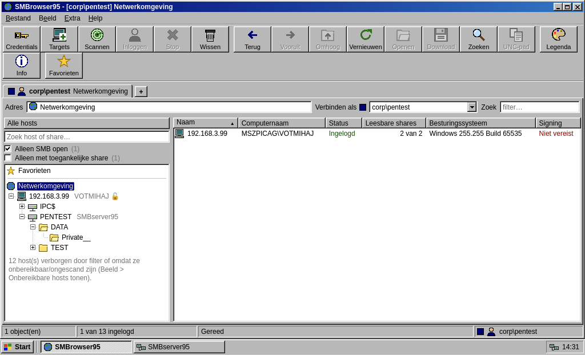
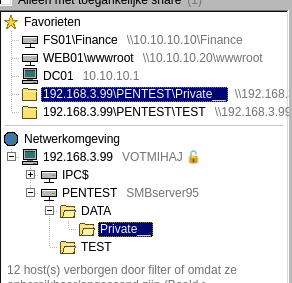

# SMBrowser95

A Windows 95-style SMB browser for penetration testers. Add a credential and an IP range, and SMBrowser95 finds every host with port 445 open, logs in, and lists all the shares. Then browse them like it's 1995.



---

## Features

**Browse**
- Tree on the left with collapsible **Network** and **Favorites** sections
- File list on the right with icons, sizes, timestamps and permission badges per entry
- Per-directory read/write access probing shown inline
- Inline preview for text, images, Office documents, PDFs and more — without downloading
- Colour-coded file categories: executables, scripts, config files, databases, archives — so `unattend.xml`, `.kdbx` and `.ps1` stand out immediately
- Hidden files toggle, category filter chips, column sorting

**Credentials & scanning**
- Multiple saved credentials (username/password, NT hash, or null session)
- One tab per credential — compare what each user can see side by side
- Scan ranges like `10.0.0.0/24` or `10.0.0.1-50`, CIDR blocks, hostnames
- Import targets from **nmap XML** or **Nessus XML** exports
- SMB dialect, signing status and guest-session detection per host

**File operations**
- Download single files or **bulk-download a selection as ZIP**
- Upload, new folder, new text file, cut/copy/paste across shares, rename, delete
- UNC path copy per file, folder or share

**Search**
- File search across an entire share — glob patterns like `*.config` or just `password` (auto-wrapped as `*password*`)
- Results are navigable: double-click opens the containing folder

**Notes & bookmarks**
- Per-host notes (shown in the tree as a badge)
- Bookmarks with a dedicated collapsible section in the left tree — add from the toolbar or by right-clicking any host or share

**SMB server**
- Host a share from a local directory with one click
- Captures incoming **NTLM hashes** (NTLMv1 and NTLMv2) in JtR/Hashcat format
- Logs every connection with timestamp, IP, port and SMB dialect
- Export hashes directly to a Hashcat-ready file
- SMB2/3 toggle for Windows 10/11 compatibility

---

## Requirements

- Python 3.8+
- [impacket](https://github.com/fortra/impacket) ≥ 0.12
- [Flask](https://flask.palletsprojects.com/) ≥ 3.0

```bash
pip install -r requirements.txt
```

---

## Getting started

```bash
git clone https://github.com/<your-username>/SMBrowser95.git
cd SMBrowser95
python3 smbbrowser.py start
```

Open **http://127.0.0.1:8445** in your browser.

```bash
# Stop
python3 smbbrowser.py stop

# Status
python3 smbbrowser.py status

# Expose on the network (adds a random password)
python3 smbbrowser.py start --expose

# Custom port
python3 smbbrowser.py start --port 9000
```

On the first run, dependencies are installed automatically if they are missing.

---

## Quickstart

1. Click **Credentials** → add a user (leave username empty for a null session, or paste an NT hash)
2. Click **Targets** → paste IPs, ranges or import an nmap/Nessus XML file
3. Click **Scan** → SMBrowser95 probes port 445 and logs in
4. Double-click a host in the tree to expand its shares, then double-click a share to browse it
5. Right-click anything for a context menu with all available actions

---

## Screenshots

<table>
  <tr>
    <td></td>
    <td></td>
  </tr>
  <tr>
    <td><em>Main view</em></td>
    <td><em>SMB server &amp; hash capture</em></td>
  </tr>
  <tr>
    <td></td>
    <td></td>
  </tr>
  <tr>
    <td><em>File search</em></td>
    <td><em>ites in tree</em></td>
  </tr>
</table>

---

## Data & privacy

All data (credentials, scan results, notes, bookmarks) is stored locally in `data/`. This folder is listed in `.gitignore` and is never committed.

```
data/
├── store.json        ← hosts + credentials
├── notes.json        ← per-host notes
├── bookmarks.json    ← saved bookmarks
├── smbserver.json    ← SMB server config
└── smbshare/         ← files served by the built-in SMB server
```

> **Only use SMBrowser95 on networks you are authorised to test.**

---

## Keyboard shortcuts

| Key | Action |
|-----|--------|
| `F5` | Refresh |
| `Backspace` | Go up one level |
| `Alt + ←` / `Alt + →` | Back / Forward |
| `Enter` | Open selected item |
| `F2` | Rename |
| `Del` | Delete |
| `Ctrl + X` / `C` / `V` | Cut / Copy / Paste |
| `Ctrl + A` | Select all |
| `Ctrl + F` | Filter list |
| `Esc` | Clear multi-selection |
| `Alt + Enter` | Properties |

---

## License

MIT
